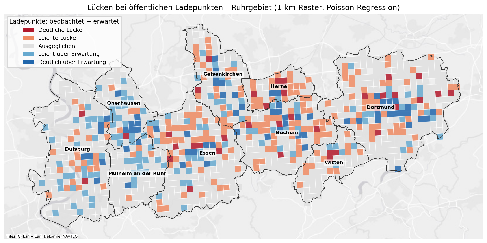
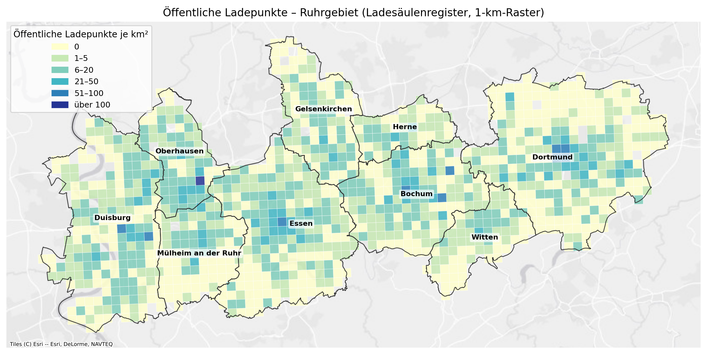
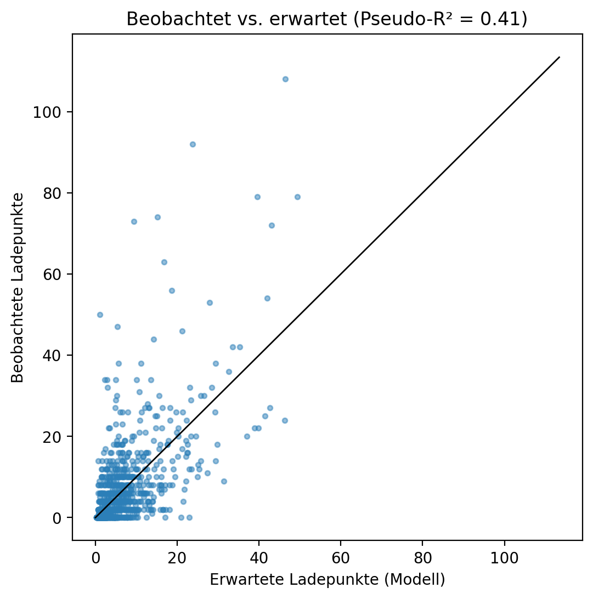

# EV Charging Gaps – Ruhr Area

[English](#ev-charging-gaps--ruhr-area) | [Deutsch](#deutsch)

Where are public charging points for electric vehicles missing? A **Poisson regression** estimates the expected number of public charging points in every populated **1 km grid cell** of nine cities in the **Ruhr area (NRW, Germany)**, using population, home ownership, age and shops as predictors. Cells with clearly fewer charging points than expected are mapped as **charging gaps**.



---

## Key results

| | |
|---|---|
| Study area | Duisburg, Essen, Mülheim an der Ruhr, Oberhausen, Gelsenkirchen, Bochum, Dortmund, Herne, Witten |
| Grid | 1,222 populated 1 km cells, 2.9 million inhabitants |
| Public charging points | **6,588** (Ladesäulenregister, Bundesnetzagentur) |
| Model | Poisson regression, McFadden pseudo R² = **0.41** |
| Clear gaps (≥ 10 points fewer than expected) | **38 cells with 252,000 inhabitants (8.7 %)** |

**Model coefficients** (IRR = change factor of the expected number of charging points)

| Predictor | IRR | Meaning |
|---|---|---|
| Shops (log) | 1.67 | Strongest factor: charging points are built where people shop |
| Inhabitants (log) | 1.10 | More inhabitants → slightly more charging points |
| Owner-occupancy rate (per % point) | 0.98 | More home owners (private wallboxes) → fewer public charging points |
| Average age (per year) | 1.03 | Slightly more charging points in older districts |

All coefficients are significant (p < 0.001).

**Charging points per city**

| City | Inhabitants | Charging points | per 1,000 inh. | Inhabitants in clear gaps |
|---|---|---|---|---|
| Herne | 136,273 | 162 | 1.19 | 23.7 % |
| Gelsenkirchen | 239,294 | 458 | 1.91 | 5.8 % |
| Mülheim an der Ruhr | 215,234 | 447 | 2.08 | 1.5 % |
| Essen | 569,732 | 1,217 | 2.14 | 8.4 % |
| Duisburg | 511,366 | 1,155 | 2.26 | 3.9 % |
| Dortmund | 577,604 | 1,336 | 2.31 | 12.8 % |
| Witten | 105,910 | 264 | 2.49 | 13.7 % |
| Bochum | 383,713 | 984 | 2.56 | 8.5 % |
| Oberhausen | 169,250 | 565 | 3.34 | 8.0 % |

**Interpretation:** public charging infrastructure follows shopping locations more than residential population. Dense residential areas with many rented flats and few shops are often under-supplied, because residents cannot install a private wallbox. **Herne** has by far the fewest charging points per inhabitant and the highest share of residents in gap areas; in absolute numbers, most residents in gap areas live in **Dortmund** and **Essen**.





---

## Workflow

1. **City boundaries** – nine cities from OpenStreetMap (OSMnx), EPSG:3035
2. **Census data** – Census 2022 1 km grid (Destatis): population, owner-occupancy rate, average age; only populated cells inside the cities
3. **Charging points** – Ladesäulenregister of the Bundesnetzagentur (CSV), number of charging points per station, counted per 1 km cell
4. **Shops** – all `shop=*` features from OpenStreetMap, counted per cell
5. **Poisson regression** (statsmodels GLM) – `charging points ~ log(inhabitants) + log(shops) + owner rate + average age`
6. **Gaps** – difference observed − expected; classes: clear gap (≤ −10), slight gap (−10 to −3), balanced, above expectation
7. **Maps and export** – maps with Esri Light Gray basemap, results as GeoPackage and CSV

## Limitations

- Only **public** charging points are included; private wallboxes and company chargers are not
- The model shows where charging points are missing **compared with similar cells**, not an absolute demand
- Shops are only one indicator of daytime activity; workplaces, parking and traffic volume are not included
- OpenStreetMap shop data can be incomplete in some areas
- The scatter plot shows overdispersion (some cells with very many charging points, e.g. car dealers or charging hubs); a negative binomial model would be a possible extension

---

## Repository structure

```
EV-Charging-Gaps-Ruhr/
├── notebooks/
│   └── ev_charging_gaps_ruhr.ipynb
├── images/
│   ├── 01_Ladeluecken_Ruhrgebiet.png
│   ├── 02_Ladepunkte_Ruhrgebiet.png
│   └── 03_Beobachtet_vs_Erwartet.png
├── results/
│   ├── ladeluecken_ruhrgebiet.gpkg   # 1 km cells: predictors, observed, expected, difference, class
│   ├── ladeluecken_je_stadt.csv
│   └── poisson_koeffizienten.csv
├── requirements.txt
├── LICENSE
└── README.md
```

The notebook runs in Google Colab and downloads the data automatically.

## Tools

Python · pandas · GeoPandas · statsmodels (Poisson GLM) · OSMnx · Matplotlib · contextily · Google Colab

## Data sources

Ladesäulenregister – © Bundesnetzagentur, CC BY 4.0. Zensus 2022 – © Statistisches Bundesamt (Destatis), Datenlizenz Deutschland – Namensnennung – Version 2.0 (dl-de/by-2-0). City boundaries and shops: © OpenStreetMap contributors (ODbL). Basemap: Esri World Light Gray Canvas.

## License

Code: MIT License – see [LICENSE](LICENSE)

---
---

# Deutsch

[English](#ev-charging-gaps--ruhr-area) | [Deutsch](#deutsch)

Wo fehlen öffentliche Ladepunkte für Elektroautos? Eine **Poisson-Regression** schätzt die erwartete Zahl öffentlicher Ladepunkte in jeder bewohnten **1-km-Gitterzelle** von neun Städten im **Ruhrgebiet (NRW)**, mit Einwohnerzahl, Eigentümerquote, Durchschnittsalter und Geschäften als Einflussgrößen. Zellen mit deutlich weniger Ladepunkten als erwartet werden als **Ladelücken** dargestellt.


---

## Zentrale Ergebnisse

| | |
|---|---|
| Untersuchungsgebiet | Duisburg, Essen, Mülheim an der Ruhr, Oberhausen, Gelsenkirchen, Bochum, Dortmund, Herne, Witten |
| Raster | 1.222 bewohnte 1-km-Zellen, 2,9 Mio. Einwohner |
| Öffentliche Ladepunkte | **6.588** (Ladesäulenregister, Bundesnetzagentur) |
| Modell | Poisson-Regression, Pseudo-R² nach McFadden = **0,41** |
| Deutliche Lücken (≥ 10 Ladepunkte weniger als erwartet) | **38 Zellen mit 252.000 Einwohnern (8,7 %)** |

**Modellkoeffizienten** (IRR = Faktor, um den sich die erwartete Zahl der Ladepunkte ändert)

| Einflussgröße | IRR | Bedeutung |
|---|---|---|
| Geschäfte (log) | 1,67 | Stärkster Faktor: Ladepunkte entstehen dort, wo eingekauft wird |
| Einwohner (log) | 1,10 | Mehr Einwohner → etwas mehr Ladepunkte |
| Eigentümerquote (je %-Punkt) | 0,98 | Mehr Wohneigentum (private Wallboxen) → weniger öffentliche Ladepunkte |
| Durchschnittsalter (je Jahr) | 1,03 | Etwas mehr Ladepunkte in älteren Gebieten |

Alle Koeffizienten sind signifikant (p < 0,001).

**Ladepunkte je Stadt**

| Stadt | Einwohner | Ladepunkte | je 1.000 EW | Einwohner in deutlichen Lücken |
|---|---|---|---|---|
| Herne | 136.273 | 162 | 1,19 | 23,7 % |
| Gelsenkirchen | 239.294 | 458 | 1,91 | 5,8 % |
| Mülheim an der Ruhr | 215.234 | 447 | 2,08 | 1,5 % |
| Essen | 569.732 | 1.217 | 2,14 | 8,4 % |
| Duisburg | 511.366 | 1.155 | 2,26 | 3,9 % |
| Dortmund | 577.604 | 1.336 | 2,31 | 12,8 % |
| Witten | 105.910 | 264 | 2,49 | 13,7 % |
| Bochum | 383.713 | 984 | 2,56 | 8,5 % |
| Oberhausen | 169.250 | 565 | 3,34 | 8,0 % |

**Interpretation:** Die öffentliche Ladeinfrastruktur folgt stärker den Einkaufsstandorten als der Wohnbevölkerung. Dichte Wohngebiete mit vielen Mietwohnungen und wenigen Geschäften sind oft unterversorgt, weil die Bewohner keine private Wallbox installieren können. **Herne** hat mit Abstand die wenigsten Ladepunkte je Einwohner und den höchsten Anteil an Einwohnern in Lückengebieten; absolut leben die meisten Einwohner in Lückengebieten in **Dortmund** und **Essen**.


---

## Arbeitsablauf

1. **Stadtgrenzen** – neun Städte aus OpenStreetMap (OSMnx), EPSG:3035
2. **Zensusdaten** – Zensus 2022, 1-km-Gitter (Destatis): Einwohner, Eigentümerquote, Durchschnittsalter; nur bewohnte Zellen innerhalb der Städte
3. **Ladepunkte** – Ladesäulenregister der Bundesnetzagentur (CSV), Zahl der Ladepunkte je Station, gezählt je 1-km-Zelle
4. **Geschäfte** – alle `shop=*`-Objekte aus OpenStreetMap, gezählt je Zelle
5. **Poisson-Regression** (statsmodels GLM) – `Ladepunkte ~ log(Einwohner) + log(Geschäfte) + Eigentümerquote + Durchschnittsalter`
6. **Lücken** – Differenz beobachtet − erwartet; Klassen: deutliche Lücke (≤ −10), leichte Lücke (−10 bis −3), ausgeglichen, über Erwartung
7. **Karten und Export** – Karten mit Esri-Light-Gray-Grundkarte, Ergebnisse als GeoPackage und CSV

## Einschränkungen

- Nur **öffentliche** Ladepunkte; private Wallboxen und Firmenladepunkte sind nicht enthalten
- Das Modell zeigt, wo Ladepunkte **im Vergleich zu ähnlichen Zellen** fehlen, keinen absoluten Bedarf
- Geschäfte sind nur ein Indikator für Aktivität am Tag; Arbeitsplätze, Parkplätze und Verkehrsmengen fehlen
- Die Geschäftsdaten aus OpenStreetMap können in einzelnen Gebieten unvollständig sein
- Das Streudiagramm zeigt Überdispersion (einzelne Zellen mit sehr vielen Ladepunkten, z. B. Autohäuser oder Ladeparks); ein negatives Binomialmodell wäre eine mögliche Erweiterung

---

## Werkzeuge

Python · pandas · GeoPandas · statsmodels (Poisson-GLM) · OSMnx · Matplotlib · contextily · Google Colab

## Datenquellen

Ladesäulenregister – © Bundesnetzagentur, CC BY 4.0. Zensus 2022 – © Statistisches Bundesamt (Destatis), Datenlizenz Deutschland – Namensnennung – Version 2.0 (dl-de/by-2-0). Stadtgrenzen und Geschäfte: © OpenStreetMap-Mitwirkende (ODbL). Grundkarte: Esri World Light Gray Canvas.

## Lizenz

Code: MIT-Lizenz – siehe [LICENSE](LICENSE)
